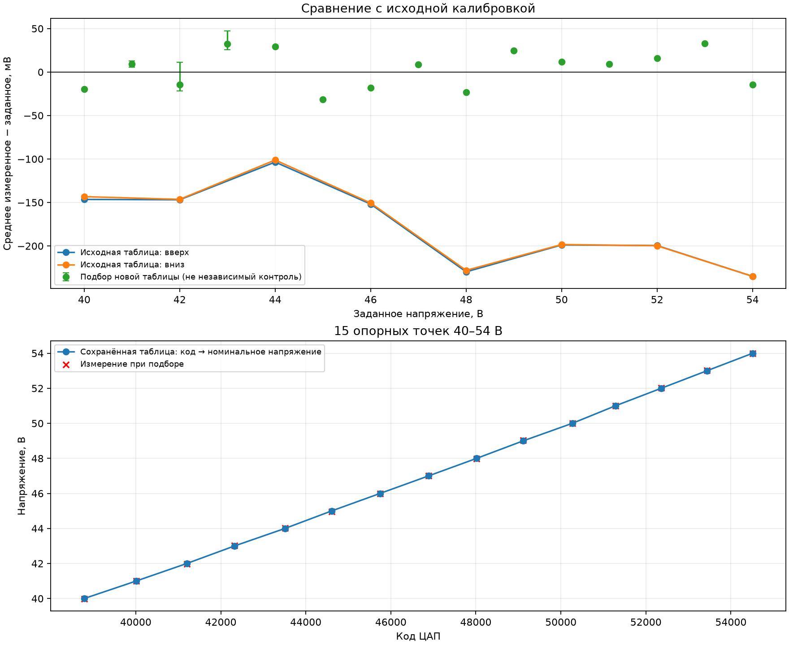
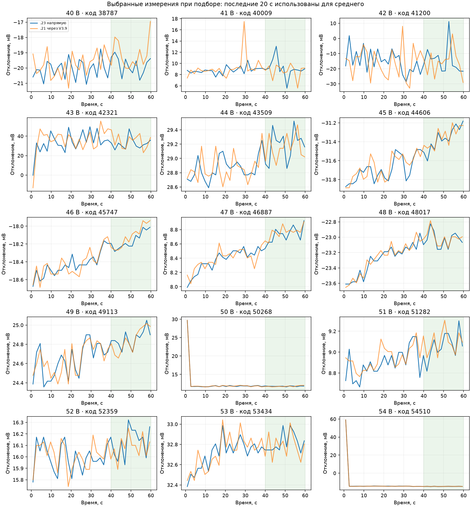

# Итог подбора калибровки RSP, 6 октября 2026

Прошивка 0.6.1 уже была установлена и соответствует текущей сборке. SHA256 образа:
`95905c10ef0801fc63ff167d5d6ced54ee1d654ed27f0493208e0b5f48b9e3d9`.

15 кодов для 40–54 В сохранены в STM32, ответ CAL? — SAVED; контрольное чтение
полностью совпало. [JSON для импорта](calibration.json), [ответ платы](result.json).

Отдельный контрольный прогон отменён владельцем. Значения ниже использованы
для выбора кодов: это остаточные отклонения при подборе, не независимая оценка
точности после сохранения. Наибольшее абсолютное отклонение среднего при подборе
— 32.82 мВ, максимальный размах выбранной выдержки — 32.81 мВ.
Поздний дрейф и влияние предыстории этим не исключены; ±0,10 В не гарантируется.

Для кандидата: 20 с на исходном коде на 1000 ниже, затем 60 с на целевом коде;
среднее и размах по последним 20 с, до трёх попыток. После обнаружения скачков
около 60–70 мВ критерий оставшегося подбора изменён с 12 на 40 мВ. Выбран один
из реально измеренных кодов с минимальным модулем отклонения среднего, без
усреднения направлений или попыток. Промежуточные напряжения после этой таблицы
по просьбе владельца не проверялись.

| Уставка, В | Код | Среднее прямого выхода, В | Отклонение, мВ | Размах, мВ |
|---|---|---|---|---|
| 40 | 38787 | 39.980180 | -19.82 | 1.84 |
| 41 | 40009 | 41.009119 | +9.12 | 7.50 |
| 42 | 41200 | 41.985517 | -14.48 | 32.81 |
| 43 | 42321 | 43.032409 | +32.41 | 21.69 |
| 44 | 43509 | 44.029179 | +29.18 | 0.66 |
| 45 | 44606 | 44.968632 | -31.37 | 0.42 |
| 46 | 45747 | 45.981842 | -18.16 | 0.27 |
| 47 | 46887 | 47.008744 | +8.74 | 0.30 |
| 48 | 48017 | 47.976976 | -23.02 | 0.33 |
| 49 | 49113 | 49.024859 | +24.86 | 0.33 |
| 50 | 50268 | 50.011775 | +11.77 | 0.27 |
| 51 | 51282 | 51.009067 | +9.07 | 0.48 |
| 52 | 52359 | 52.016128 | +16.13 | 0.39 |
| 53 | 53434 | 53.032825 | +32.82 | 0.27 |
| 54 | 54510 | 53.985312 | -14.69 | 0.33 |

RSP и HLG выключены; SAFE завершён. При заключительном измерении прямой выход
RSP 0.580900 В (<1 В). Соединения с приборами закрыты.

Полный журнал и исходные отсчёты сохранены в рабочей папке
`C:/Users/user/Documents/Codex/2026-09-17/1-2/outputs/step6-calibration/`:
`refinement-164330` (40–45 В), `refinement-final` (продолжение и сводные отсчёты).
Программные проверки: 17 CTest, 81 Python-тест, 125 общих диалоговых проверок
C-хоста, отдельный Node-тест поведения редактора калибровки. Проверка UI в Chrome
и ручные испытания RSP/HLG остаются открыты; весь шаг 6 не объявляется закрытым.
